# CIC Learn: a curriculum and student progress platform for Coding in Color

Built by **Code Titans** at the [ASU Fall Hackathon 2026, Phoenix Hackathon for Nonprofits](https://www.ohack.dev/hack/fall-2026) (Nov 14-15) for the public good. MIT license.

**Live site:** https://main.d3voqx7r17ipz6.amplifyapp.com (students open `/s`, staff sign in at `/login`)

[Coding in Color](https://www.ohack.dev/nonprofit/YIXYdYCoxIZC08uQ5DL3) (CIC) teaches computer science to students across Arizona. CIC Learn lets a teacher put a class on CIC's curriculum in minutes, lets each student work through lessons at their own pace without an account, and shows teachers and CIC what was actually learned.

| | |
|---|---|
| Nonprofit | [Coding in Color](https://www.ohack.dev/nonprofit/YIXYdYCoxIZC08uQ5DL3) |
| Problem statement | [Curriculum & Student Progress Platform (CIC Problem 1)](https://www.ohack.dev/project/d09466fadf1b11f18e63deadc507a848) |
| Team | [Code Titans](https://www.ohack.dev/hack/fall-2026/team/b392ef8ce05f11f18371deadfb009123) |
| Demo video | Linked from the team dashboard |

## Contents
[What it does](#what-it-does) · [Screenshots](#screenshots) · [Tech stack](#tech-stack) · [Architecture](#architecture) · [Repository layout](#repository-layout) · [Run it locally](#run-it-locally) · [Configuration](#configuration) · [Deploy](#deploy) · [Security](#security-and-privacy) · [Accessibility](#accessibility) · [Testing](#testing-and-quality) · [Documentation index](#documentation-index) · [Limitations and next steps](#known-limitations-and-next-steps) · [Team](#team)

## What it does

**For students.** No email, no password. A teacher prints a login sheet; a student opens their link, or types the class code and three secret words. Each lesson is a short path of steps: pretest, video or slides, checks, worksheets, **coding exercises** and a post-test. Students who join late land on the module their class is on and can catch up on earlier ones. A student who is stuck can ask an **AI hint** that nudges without giving the answer, and there is a free **Code runner** for practice.

**For teachers.** Upload the class list from a spreadsheet, pick modules, print the login sheets. The dashboard shows who is stuck or has not started, per-student progress, **learning gain** from pretest to post-test, and **mastery per concept** ("33% of the class reached 80% on loops"). Worksheets that need a human go to a review queue. Grades can be exported to CSV.

**For CIC.** Admins invite staff, manage schools and cohorts, and author and publish curriculum (instructors can be made "curriculum authors"). A read-only **API with keys** feeds CIC's own dashboard with aggregated results only. Teachers outside CIC can **request an account**; an admin approves, and they run their own classes on CIC's curriculum. CIC sees usage counts for those classes and nothing about their students.

### Who can do what

| Role | How they sign in | Can |
|---|---|---|
| Student | Class code + 3 secret words | Do their own lessons, ask for hints, use the Code runner |
| Instructor (CIC) | Cognito, MFA | Run their classes, see their students' progress. Browse and assign published modules |
| Curriculum author | Instructor with an admin-set flag | Also create, edit and publish any module |
| CIC admin | Cognito, MFA | Everything on CIC's side: users, schools, cohorts, API keys, audit log, access requests, usage |
| External teacher | Cognito, MFA, after admin approval | Run their own classes. CIC cannot see their students |
| Reviewer | Cognito, MFA | Preview published curriculum only. No class or student data |
| CIC dashboard (machine) | API key | Read aggregated cohort results |

## Screenshots

Screens below use sample data (made-up names), except the two public pages, which are the live site.

| | |
|---|---|
| 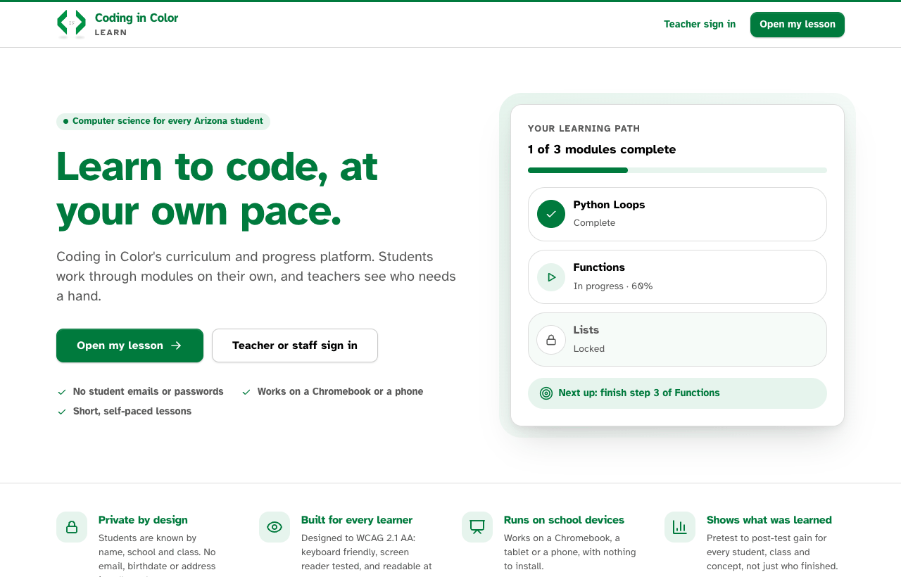 **Home page.** Students and teachers start here. | 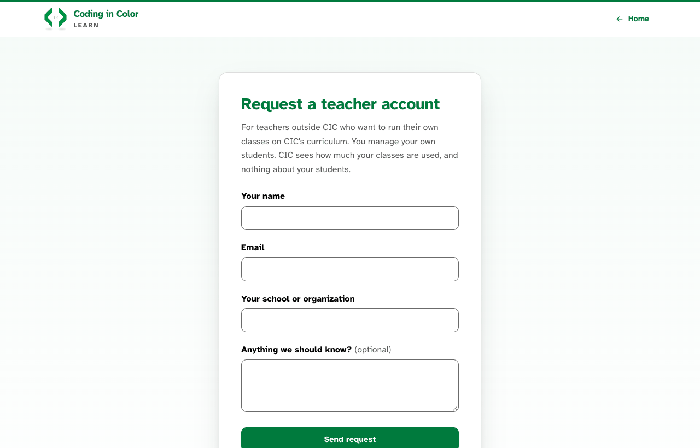 **Request a teacher account.** A teacher outside CIC asks; an admin approves. |
| 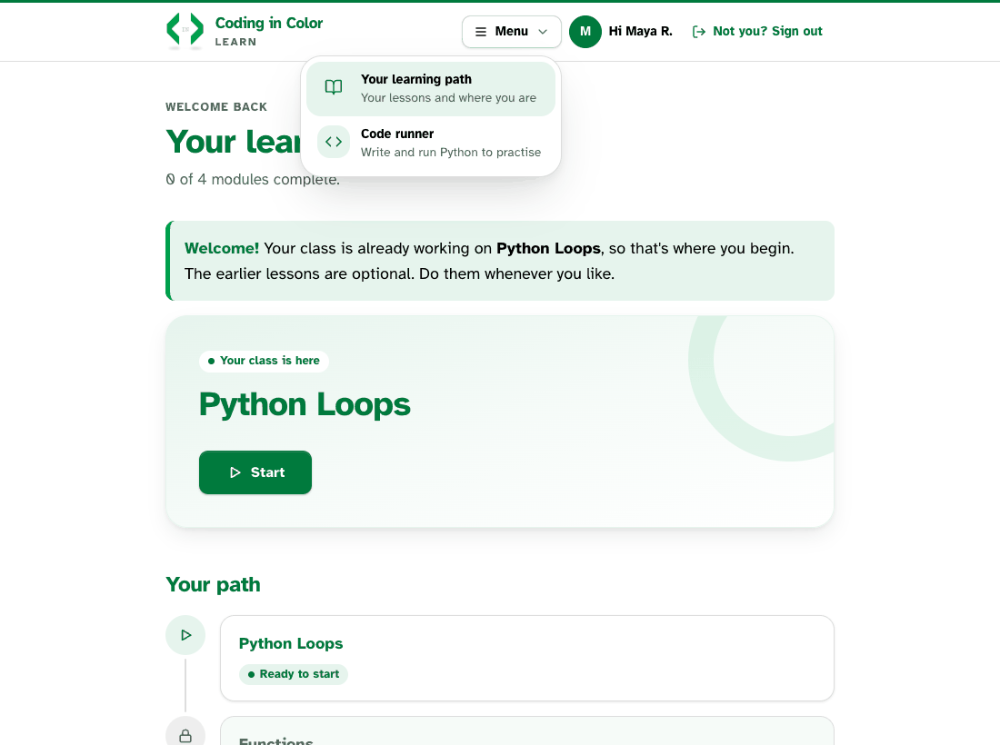 **Student dashboard.** The Menu opens the learning path and the Code runner. | 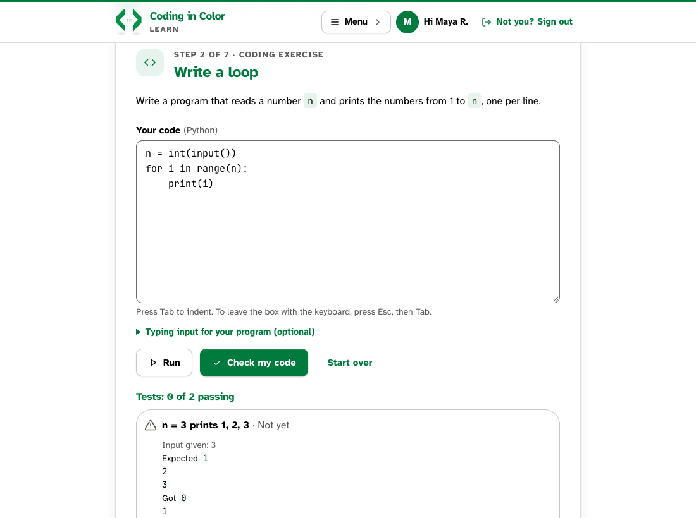 **Coding exercise.** Instant feedback: each test passes or shows what was expected and what the code gave. |
| 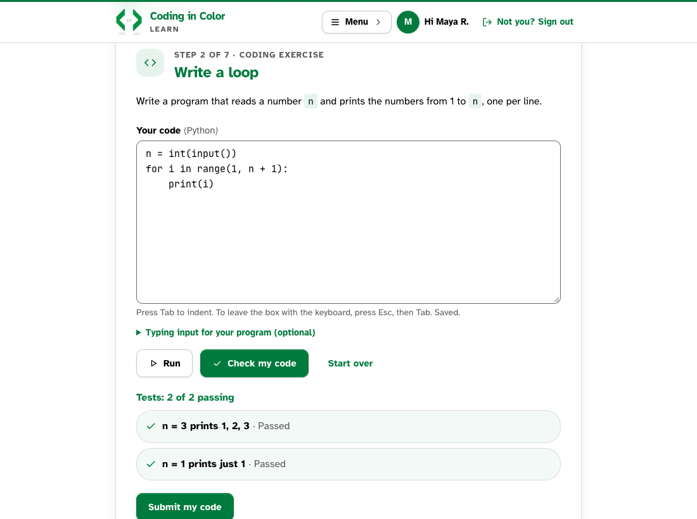 **All tests passing.** Submitting saves the code for the teacher. | 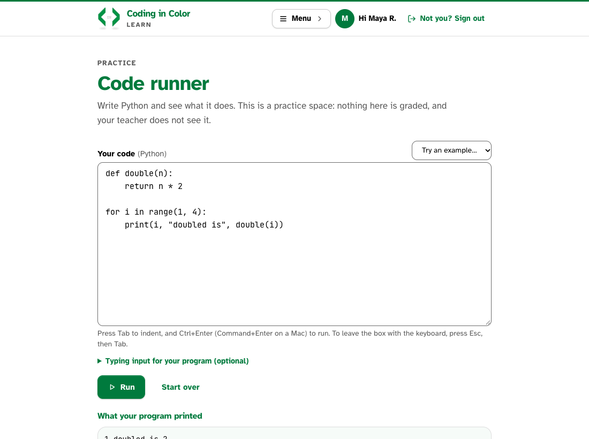 **Code runner.** Practice Python in the browser. Nothing is graded or saved on the server. |
| 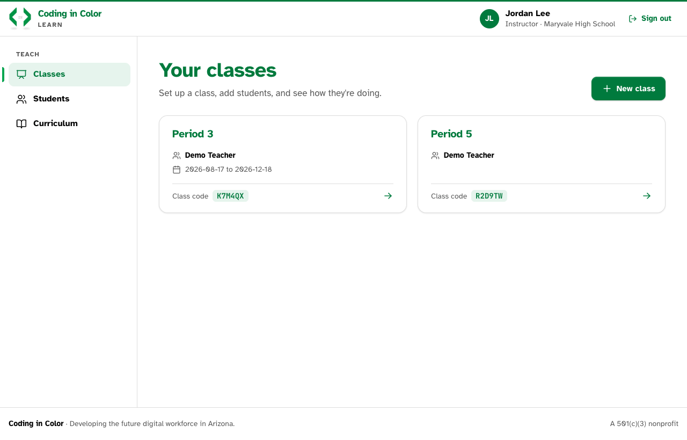 **Teacher: classes.** | 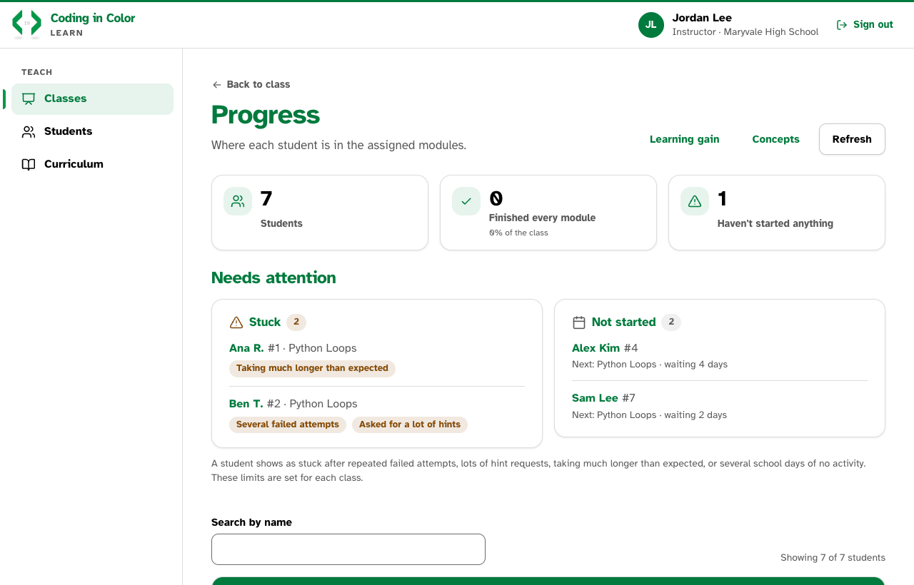 **Teacher: progress.** Who is stuck, who has not started, every student's place. |
| 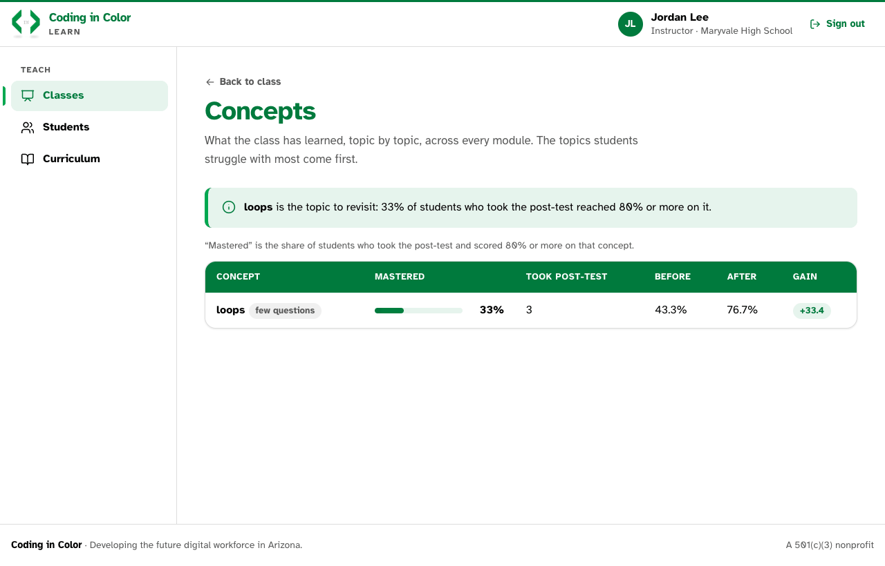 **Teacher: concepts.** Which topics the class has mastered. | 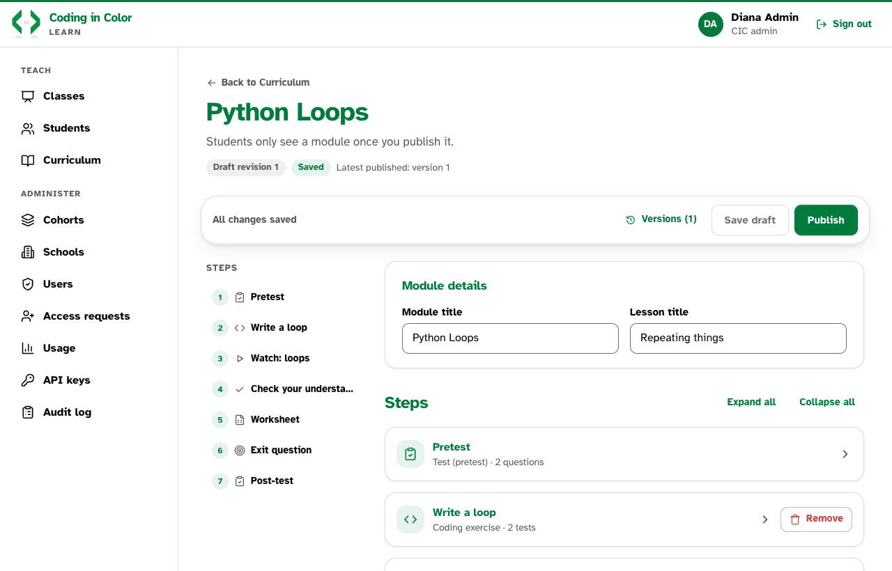 **Module editor.** Steps collapse into a short list with an outline. |
| 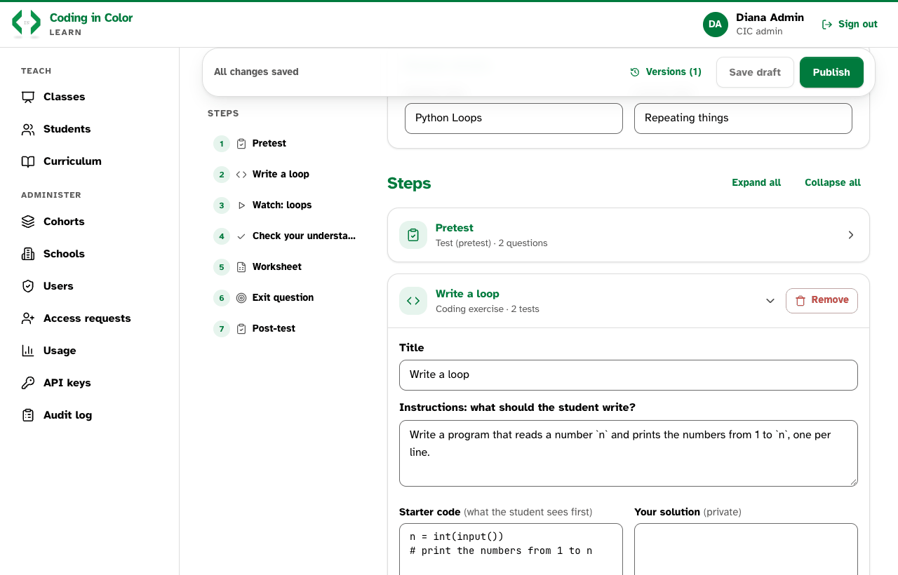 **Authoring a coding exercise.** Starter code, a private solution, and tests. | 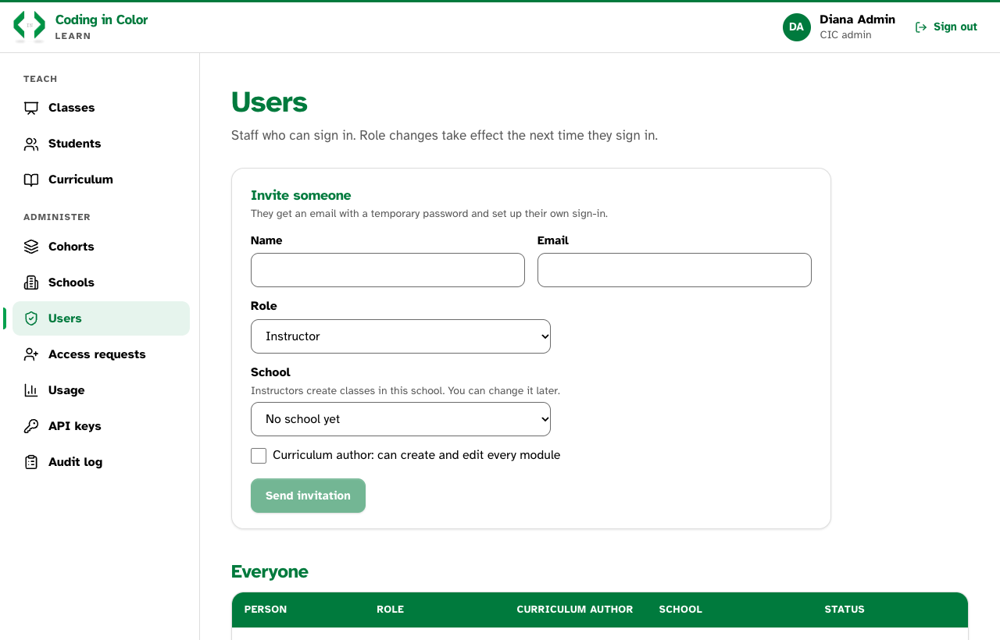 **Admin: users.** Invite staff, set roles, assign schools. |
| 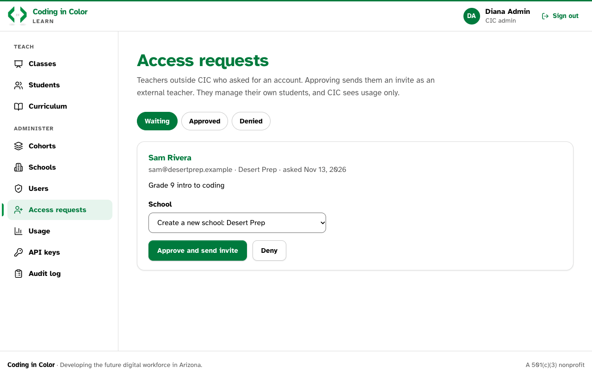 **Admin: access requests.** Approve or deny teachers outside CIC. | 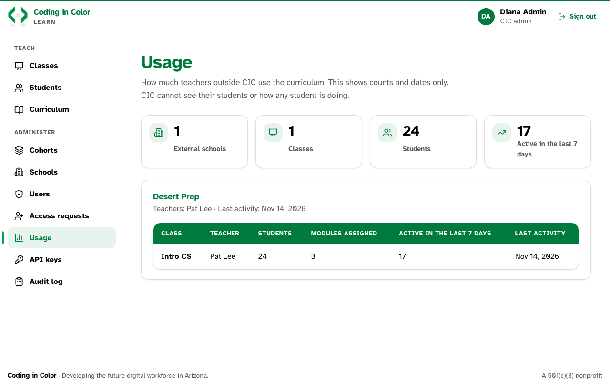 **Admin: usage.** Counts and dates for external classes, never student data. |

## Tech stack

| Layer | Technology | Notes |
|---|---|---|
| Frontend | **Next.js 16** (App Router, static export), **React 19**, **TypeScript 5** | Pure static site, so hosting is a folder of files |
| Styling | **Tailwind CSS 4**, CIC brand tokens in `frontend/app/globals.css` | Atkinson Hyperlegible font for readability |
| Data fetching | **TanStack Query 5** | Caching, retries, loading and error states |
| Demo data | **Mock Service Worker 2** | The whole UI runs offline against fake data |
| In-browser Python | **Pyodide 314** (Python in WebAssembly) in a Web Worker | Runs student code on the student's device, loaded from the jsDelivr CDN |
| API | **Amazon API Gateway** (HTTP API) | JWT authorizer for staff, Lambda authorizers for students and API keys |
| Compute | **AWS Lambda**, **Python 3.12**, one function per domain, one shared layer | Handlers stay thin; rules live in `cic.*` modules |
| Infrastructure | **AWS CDK 2** in **TypeScript** | Everything is code; nothing is configured by hand |
| Database | **Amazon DynamoDB**, four tables (content, core, progress, events) | On-demand billing, encryption, point-in-time recovery, TTL for logs |
| Staff identity | **Amazon Cognito** | Invite-only, TOTP MFA required, roles are groups |
| Secrets | **AWS Secrets Manager** | Pepper for student credentials. No secret is in the repo |
| AI hints | **Amazon Bedrock**, Amazon Nova Lite | One named model, monthly cap, every reply checked on the server |
| Images | **S3 + CloudFront** | Curriculum images, private bucket served through a CDN |
| Hosting | **AWS Amplify Hosting** | Manual zip deployment, adds HSTS and other security headers |
| Tests | **pytest + moto**, **jest** (CDK assertions), **ESLint**, **axe-core** | No AWS access needed to run them |

The reasons for these choices are in [docs/decisions.md](docs/decisions.md).

## Architecture

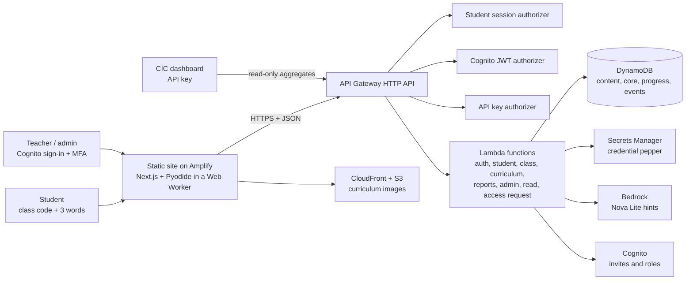

- **One API, three ways in.** Students use a session token from a class code and secret words. Staff use a Cognito token. CIC's dashboard uses an API key. Each has its own authorizer, and every handler still checks the caller's role itself (`backend/lambda/shared-layer/python/cic/authz.py`).
- **Data.** `content` holds modules (drafts and immutable published versions). `core` holds schools, classes, rosters, assignments, users, sessions and keys. `progress` holds activity state, assessments and submissions. `events` holds the audit log and hint logs and expires old entries. Key shapes are in [docs/architecture.md](docs/architecture.md) section 6.
- **Versioned curriculum.** Publishing creates a new immutable version. A class keeps the version it was assigned until its teacher moves it, so students never see a lesson change under them.
- **Code runs in the browser.** The server never executes student code. See the decision record for why, and what it means for trust.
- **Deep dive.** [docs/architecture.md](docs/architecture.md) covers the model, rules and diagrams. [docs/api.md](docs/api.md) lists every endpoint with who may call it, and maps each route to its Lambda.

## Repository layout

```
.
├── frontend/               Next.js app (static export)
│   ├── app/                Pages (App Router), components by feature, API client, mock data
│   │   ├── components/     player/ instructor/ author/ admin/ curriculum/ common/
│   │   ├── lib/api/        One typed client module per area of the API
│   │   ├── lib/pyodide/    In-browser Python runner and test checking
│   │   └── mocks/          Mock Service Worker handlers for demo mode
│   └── public/             Brand images, Pyodide worker and harness
├── backend/
│   ├── bin/ lib/           CDK app, stacks (data, auth, api) and one construct per API domain
│   ├── lambda/             One folder per Lambda; shared-layer/python/cic holds the shared rules
│   ├── seed/               The sample "Python Practice" module and the script that loads it
│   └── test/               pytest (Lambdas) and jest (CDK), mirroring the source layout
├── docs/                   architecture.md, api.md, decisions.md, operations.md, screenshots, brand files
├── AGENTS.md CLAUDE.md     Working agreements for AI coding tools (small PRs, one repo)
└── .github/workflows/      Pull request size and description check
```

## Run it locally

You need **Node 20+** and, for the backend tests, **Python 3.12+**. Nothing here needs AWS access.

### 1. The app on sample data (the fastest start)

```bash
git clone https://github.com/2026-Arizona-Opportunity-Hack/Code-Titans-CodinginColor.git
cd Code-Titans-CodinginColor/frontend
cp .env.example .env.local        # leave NEXT_PUBLIC_USE_MOCKS=true
npm install
npm run dev                       # http://localhost:3000
```

- **Student:** open http://localhost:3000/s/#K7M4QX.maple-tiger-blue (class code `K7M4QX`, words `maple-tiger-blue`). You land signed in as the sample student.
- **Teacher, admin, reviewer:** open http://localhost:3000/login/ and choose a sample role. No password is needed in sample mode.
- The first Python run downloads about 12 MB (cached afterwards), so the machine needs internet.

### 2. The app against a deployed backend

Deploy the backend first (see [Deploy](#deploy)), then in `frontend/.env.local` set `NEXT_PUBLIC_USE_MOCKS=false` and fill in the API and Cognito values from the stack outputs. Restart `npm run dev`.

### 3. Tests and checks

```bash
# Frontend
cd frontend && npm run lint && npx tsc --noEmit

# Backend
cd backend && npm install
npm test                                   # CDK assertion tests (jest)
python3 -m venv .venv && . .venv/bin/activate
pip install -r requirements-dev.txt        # boto3, moto, pytest
python3 -m pytest test -q -p no:cacheprovider   # Lambda tests against moto
npx tsc --noEmit
```

## Configuration

### Frontend (`frontend/.env.local`, copy from `.env.example`)

Only `NEXT_PUBLIC_` values reach the browser, so **never put a secret in them**. The file is git-ignored.

| Variable | Needed when | What it is |
|---|---|---|
| `NEXT_PUBLIC_USE_MOCKS` | Always | `true` serves fake data with no backend. `false` calls the real API. **Must be `false` for a production build** |
| `NEXT_PUBLIC_API_URL` | Mocks off | API base URL including `/v1` (stack output `ApiUrl` plus `/v1`) |
| `NEXT_PUBLIC_AWS_REGION` | Mocks off | Region of the Cognito pool, for example `us-west-2` |
| `NEXT_PUBLIC_COGNITO_USER_POOL_ID` | Mocks off | Stack output `UserPoolId` |
| `NEXT_PUBLIC_COGNITO_CLIENT_ID` | Mocks off | Stack output `UserPoolClientId` |
| `NEXT_PUBLIC_PYODIDE_URL` | Optional | Where Python is loaded from. Default is the jsDelivr CDN. Set it to a copy you host (with a trailing slash) if school networks block the CDN |

### Backend (CDK context in `backend/cdk.json`, or `-c key=value` on the command line)

| Key | Default | What it does |
|---|---|---|
| `allowedOrigins` | none, **required** | Comma-separated browser origins allowed by CORS: the hosted site and `http://localhost:3000`. Never `*` |
| `staffMfa` | `REQUIRED` | `REQUIRED` or `OPTIONAL`. Cognito applies MFA to the whole pool |
| `bedrockRegion` | `us-west-2` | Region where the hint model is called |
| `hintModelId` | `amazon.nova-lite-v1:0` | The one model the hint Lambda may invoke |
| `hintsMonthlyCap` | `5000` | Hard cap on hints for the whole app per month. Keeps the AI bill predictable |

Lambda environment variables (table names, the Cognito pool, the pepper secret ARN) are set by CDK. You do not set them by hand.

## Deploy

Full runbook, including operations and troubleshooting: **[docs/operations.md](docs/operations.md)**. The short version:

```bash
# One time per AWS account and region
cd backend && npm install
export AWS_PROFILE=<your profile> AWS_REGION=us-west-2
npx cdk bootstrap

# Backend: review, then deploy (data, auth and api stacks)
npx cdk diff
npx cdk deploy --all
```

1. Note the stack outputs: `ApiUrl`, `UserPoolId`, `UserPoolClientId`.
2. **Create the first admin** (Cognito is invite-only, so nobody can sign up by themselves). The two commands are in [operations.md](docs/operations.md#create-the-first-admin).
3. Put the outputs in `frontend/.env.local` with `NEXT_PUBLIC_USE_MOCKS=false`.
4. **Publish the frontend** (a static export uploaded to Amplify; no Git connection needed):

   ```bash
   cd frontend && npm run build               # writes frontend/out/
   (cd out && zip -qr /tmp/site.zip .)
   aws amplify create-deployment --app-id <appId> --branch-name main     # returns jobId and zipUploadUrl
   curl -X PUT -H "Content-Type: application/zip" --data-binary @/tmp/site.zip "<zipUploadUrl>"
   aws amplify start-deployment --app-id <appId> --branch-name main --job-id <jobId>
   ```
   The current app id and the first-time Amplify setup are in [backend/README.md](backend/README.md#frontend-hosting).
5. Add the hosted URL to `allowedOrigins` in `backend/cdk.json` and redeploy the backend, so the browser may call the API.
6. Optional: load the sample module with `python3 backend/seed/seed_module.py backend/seed/python-practice.json --apply`.

Tables and the user pool use `RETAIN`, so deleting a stack never deletes data.

## Security and privacy

- **Data minimization.** Students are a name, a school and a class. No email, birthdate or address. An optional school-issued student ID is stored only if the school provides it.
- **Authentication.** Staff use Cognito: invite-only, TOTP MFA required, 12-character passwords. Students have no account. Their secret words are checked as an HMAC with a pepper held in Secrets Manager, with per-class rate limiting (10 failures in 5 minutes) and teacher reset.
- **Authorization.** Roles are Cognito groups, and each Lambda checks them (`cic.authz`) before touching data. A teacher can only open classes they belong to. Reviewers see no student data. An admin is refused on an external teacher's class. A student can only see their own progress.
- **Secrets.** None are committed. `.env*` files are git-ignored (only `.env.example` is tracked). API keys are shown once and only their SHA-256 hash is stored.
- **Input.** Every request body is validated, with unknown fields rejected. Module text is rendered as text, never HTML. CSV exports are protected against spreadsheet formula injection. Module content is size and shape checked on save and again on publish.
- **Student code.** It runs in the student's own browser sandbox (WebAssembly in a Web Worker), never on our servers, with an output cap and a 5-second limit.
- **AI hints.** The prompt has no name and no answer key (only a "do not say" list). Student text is passed as quoted data. Every reply is checked on the server before a student sees it. Hints are never available on tests, are limited per student and per month, and are logged for teachers for 180 days.
- **Transport and storage.** HTTPS only. DynamoDB and S3 are encrypted. The image bucket is private, served only through CloudFront. Amplify adds HSTS, `X-Frame-Options: DENY`, `nosniff` and a strict referrer policy. CORS is an explicit list. Logs carry IDs and counts, never names or emails.
- **Audit.** API key changes, exports and access-request decisions are written to an audit log that admins can read.

## Accessibility

The interface targets WCAG 2.1 AA: keyboard operation everywhere (including the code box, where Esc then Tab leaves it), visible focus, labelled controls, status messages announced to screen readers, a readable font, and colour is never the only signal. Every screen was scanned with axe-core with no violations. Student screens are designed phone-first.

## Testing and quality

- **532 pytest tests** run the real Lambda handlers against an in-memory DynamoDB (moto), including end-to-end paths: roster to student login to lesson to report to read API. They include a test for every cross-access case (a teacher to another class, an admin to an external class, a student to another student, a reviewer to student data).
- **81 jest tests** assert the CDK stacks: routes match the Lambdas, throttles, least-privilege IAM, MFA, encryption.
- **Frontend:** `tsc --noEmit` and ESLint pass, and axe-core scans pass on the screens.
- **CI:** a pull request check nudges toward small PRs with clear descriptions. See [AGENTS.md](AGENTS.md).
- The in-browser Python runner was verified in Chrome and under Node with real Pyodide. A smoke test against the deployed API covered login, the exercise, hints and cleanup.

## Documentation index

| File | What is in it |
|---|---|
| [docs/architecture.md](docs/architecture.md) | The model, roles, rules, data model, build plan, security |
| [docs/api.md](docs/api.md) | Every endpoint, who can call it, request and response shapes, and the route-to-Lambda map |
| [docs/decisions.md](docs/decisions.md) | Why the key choices were made, and what was rejected |
| [docs/operations.md](docs/operations.md) | Deploy, first admin, daily tasks, monitoring, costs, backups, teardown, troubleshooting |
| [backend/README.md](backend/README.md) | Backend layout, commands, adding an endpoint, frontend hosting |
| [docs/brand/](docs/brand) | CIC logo source files |

Code comments explain the reasons and rules that are not obvious (authorization, hint checks, grading, key shapes). Each Lambda module opens with a docstring saying what it does.

## Known limitations and next steps

Honest list of what remains before this is a finished product:

- **Coding exercise results are self-reported.** The browser runs the tests, so a student could fake a pass. Teachers can read the submitted code. Server-side grading would need a sandboxed runner. Exercises are practice and never replace the pre-test and post-test.
- **Pyodide loads from a public CDN** (about 12 MB the first time). Self-host it through `NEXT_PUBLIC_PYODIDE_URL` for schools that block the CDN.
- **Merging a roster duplicate** (`POST /classes/{id}/roster/{studentId}/merge`) is designed but not built. Duplicates are flagged for a teacher to resolve.
- **Gradebook export, low-bandwidth mode and a teacher summary of hints** are not built.
- **Frontend publishing is manual** (zip upload). Connecting Amplify to GitHub would automate it.
- **Cognito's default email sender** is limited to a small number of invites per day. Switch to Amazon SES for a larger rollout.
- **Cost** is expected to stay in the low single-digit dollars per month at classroom scale. That is an estimate from AWS pricing, not a measured bill.

## Team

- [Harsh Tita](https://github.com/iamharshtita)
- [Rashi Sharma](https://github.com/rashi-24)
- [Sreeram S](https://github.com/sreeram2001)
- [Shashwat Dwivedi](https://github.com/shash-kernels)

## License

[MIT](LICENSE). Everything here is open source. Please keep it that way.

After the hackathon, the [Definition of Done](https://www.ohack.dev/about/completion) (deployed, nonprofit sign-off, docs, open source) is tracked on the team page.
