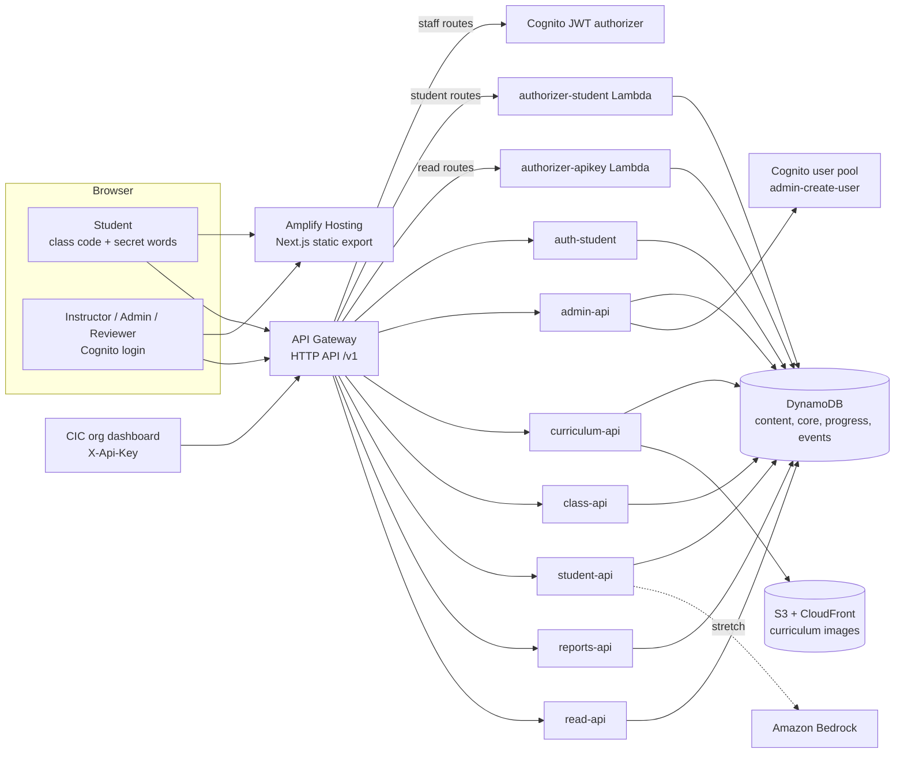

# Architecture: Curriculum & Student Progress Platform

Status: design draft for review. Nothing here is built yet.
Companion document: [api.md](api.md) (REST endpoints).

## 1. Scope

CIC Problem 1. The platform teaches, the instructor manages. A teacher shares a class code (or link), students work through modules at their own pace, and CIC can measure learning gain without a spreadsheet.

### What the judges see on Sunday, and what must run

| Outcome | Demo must show |
|---|---|
| The platform teaches | A student, with no instructor help, completes a module (video, check, worksheet, exit question) and the next module unlocks. |
| Nobody falls behind | A student who joins late lands on the right module and catches up. |
| Learning is measurable | Pretest and post-test for one module. Learning gain per student and per class. |
| CIC's dashboard sees it | An authenticated read API returns cohort stats, already aggregated, with a key. |

### "Beyond the normal scope" pick (one required)

**Primary: learning gain as the headline metric.** Gain per concept, per class, per cohort, exportable.
Why: it reuses P0 data (pre/post pairs) and only adds concept tags on questions, so the cost is low and the funder value is high ("students gained 32 points on loops").

**Specified but not committed (stretch):** Socratic hints that log what students struggled with (`POST /v1/student/hints`, `events` table). It reuses the same concept tags. Build it only if the primary pick is finished and demoable.

## 2. Constraints and principles

- **Budget:** under $20/month for the nonprofit. Target about $3 to $6.
- **Stack** (CIC standards): Next.js + TypeScript on Amplify, CDK in TypeScript, Python 3.12 Lambdas, DynamoDB, Cognito, HTTP API.
- **No student accounts.** CIC chose CodeHS at camp to avoid them. Students sign in with a class code plus their own secret words (section 5).
- **The server decides.** Grading, unlocking, and authorization happen in Lambdas. The browser is never trusted for those.
- **Minimize student data.** Display name, school (org) and class. An optional school-issued student ID is stored only if the school supplies one (section 6). No email, birthdate, or address.
- **Simplest thing the nonprofit can run after the weekend.** No scheduler, no queues, no VPC.

## 3. System diagram



## 4. Components

| Component | Choice | Notes |
|---|---|---|
| Frontend | Next.js (App Router), static export, Amplify Hosting | No SSR server to pay for or secure. See section 8. |
| API | API Gateway **HTTP API**, `/v1` | $1 per million calls. Native Cognito JWT authorizer. |
| Compute | Python 3.12 Lambdas, one per domain | Handler per domain with a small internal router. |
| Database | DynamoDB on-demand, PITR, AWS-managed encryption | Four tables (section 6). |
| Staff auth | Cognito user pool, groups `cic_admin`, `instructor`, `reviewer` | Invite-only, no self sign-up. TOTP MFA. Cognito applies MFA per pool, not per group, so it is required for all staff (open decision 10). Managed Login is used for the staff sign-in screens. |
| Student auth | Custom: class code + per-student secret words, opaque session, behind a small identity interface | Deviation from the "use Cognito" standard (section 11). SSO can be added later without changing the API. |
| Files | S3 behind CloudFront (OAC) for curriculum images | Roster CSVs are posted as JSON text, so no upload bucket is needed. |
| Video | Unlisted YouTube embeds (`youtube-nocookie.com`) | Free bandwidth and captions. |
| Secrets | Secrets Manager: credential pepper (1 secret now), GitHub token for Amplify (added when hosting is wired up) | About $0.40 per secret per month. Bedrock needs no key; the Lambda role is the credential. |
| AI (stretch) | Amazon Bedrock, one small model, invoked with the Lambda's IAM role | Decided. Policy names the specific model ARN. Model ID to be confirmed for the deploy region. Hard monthly cap. |
| Ops | CloudWatch 14-day retention, one AWS Budget | No WAF, VPC, X-Ray, or custom KMS keys. |

## 5. Identity and access

### Roles

| Role | Identity | Can do |
|---|---|---|
| `student` | Class code + own secret words | Own progress only. Take assigned modules. |
| `instructor` | Cognito, group `instructor` | Manage classes they are a member of: roster, assignments, dashboards. Read published curriculum. |
| `cic_admin` | Cognito, group `cic_admin` | Everything: all classes, authoring and publishing, users, cohorts, API keys. |
| `reviewer` | Cognito, group `reviewer` | Read published curriculum only. **No student data. No class data.** |

Authorization is enforced in the Lambda, using the verified identity from the authorizer:

- Instructor endpoints call `require_class_member(user, classId)` before any read or write.
- Student endpoints take `studentId` and `classId` from the authorizer context, never from the request body or path.
- Only `cic_admin` can manage users, cohorts, schools, and API keys.
- **Curriculum writes** (create, edit draft, publish) are allowed for `cic_admin` and for any staff user with the **`canAuthor`** flag. An admin sets the flag per user (default off, so partner-school teachers cannot edit shared curriculum). It is a permission, not a fifth role. `GET /me` returns it so the UI can show or hide authoring. Every publish is written to the audit log. Reviewers can never write.
- Student-facing module payloads are sanitized: answer keys and explanations are removed server-side.

### Student access

Passwordless, with no email and no account. A student types the **class code** and **their own secret words** (for example `maple-tiger-blue`). The class code alone grants nothing. The roster is never shown before sign-in, so nobody can pick a classmate's name from a list. After a successful login the app greets the student by name.

1. The instructor imports a roster (display names only). The system generates one credential per student: three words from a curated list of 2,048 short, common words, unique within the class. The instructor prints or shares a **login sheet** with the class code and each student's words. Words are easier for 14 to 18 year olds to type on a Chromebook than random characters, and need no extra assets, which keeps the screen accessible. Picture passwords (as Code.org uses) are not used for that reason and because they cost more to build.
2. **Convenience link.** The same credential can be presented as `https://<app>/s#<classCode>.<words>`, which the frontend can also render as a QR code. The fragment is not sent to the server, logs, or `Referer`. The page posts it to the same login endpoint and clears it with `history.replaceState`. This is a presentation of the same credential, not a second mechanism.
3. **Storage.** The server stores `HMAC-SHA256(pepper, classId + words)`, never the words. The pepper lives in Secrets Manager and is cached in the Lambda. Plain hashing would be unsafe here, because three words from 2,048 is about 33 bits and could be cracked offline if the table leaked. Without the pepper, a leaked table is not enough.
4. **Session.** An opaque random token (128 bits), stored as `sha256` in `core` with an 8-hour TTL, sent as `Authorization: Bearer`. The student authorizer resolves it, caches for 60 seconds, and returns `{studentId, classId}`. The session records the student's `credVersion`. Resetting a credential bumps `credVersion`, which invalidates that student's sessions within a minute.
5. **Rate limiting** (three layers):
   - API Gateway throttling on `/auth/*`.
   - A **per-class failure counter** in DynamoDB (atomic increment, expiring window). After 10 failures in 5 minutes, logins for that class code return 429 with `Retry-After` for 5 minutes. A failed guess cannot be tied to a student, so the limit is per class.
   - Uniform error responses and uniform timing, whether the class code or the words were wrong.

   Per-IP limits are unreliable because a school usually shares one address, and HTTP APIs cannot rate-limit by IP without WAF (extra cost). Odds check: with 30 students and 2^33 possible credentials, one guess succeeds with probability about 3.5e-9. At the limit of 10 guesses per 5 minutes, that is not a realistic attack.
6. **Reset.** An instructor can reset one student's words or regenerate the whole sheet. The old credential stops working and sessions are revoked. An instructor can also rotate the class code. New words are shown once, because only the HMAC is stored.
7. **Identity interface.** Student login goes through one small interface in the shared layer (`identity/`): `authenticate(credentials) -> StudentPrincipal{studentId, classId}`. The default implementation is class code plus secret words. A school-specific SSO provider can be added later as another implementation, and the rest of the API only sees the resulting principal. Instructors and CIC admins always use real Cognito logins with role-based access.
8. **Shared Chromebooks.** The session lives in `sessionStorage`, so closing the tab signs out. The UI has a visible "Not you? Sign out" control.

### Read API keys

- Format: `cic_<keyId>_<secret>`. Created by `cic_admin`, shown once, stored as `sha256(secret)` plus scopes and a label.
- Sent as `X-Api-Key`. The authorizer looks up `keyId`, compares hashes in constant time, checks `revokedAt`, and passes scopes as context.
- Scope `read:cohorts` only. Keys are read-only and can be revoked from the admin UI. `lastUsedAt` is recorded.
- Responses are aggregates. Groups smaller than 5 students are suppressed (section 7.5).

## 6. Data model

Four DynamoDB tables. Keys are `pk`/`sk` strings. All on-demand, PITR, AWS-managed encryption, `RETAIN`.

### `content` table: curriculum

| pk | sk | Contents |
|---|---|---|
| `MOD#<moduleId>` | `META` | title, slug, status, `latestVersion`, concepts, estimated minutes |
| `MOD#<moduleId>` | `DRAFT` | full editable module document, `revision` counter |
| `MOD#<moduleId>` | `V#0003` | **immutable** published snapshot |

A module document is one JSON item (well under the 400 KB item limit):

```json
{
  "moduleId": "py-loops", "title": "Loops",
  "lessons": [{
    "lessonId": "l1", "title": "Repeating things",
    "activities": [
      {"activityId": "a-pre",  "type": "assessment", "role": "pre",  "questions": [ ... ]},
      {"activityId": "a-vid",  "type": "video", "provider": "youtube", "videoId": "..."},
      {"activityId": "a-chk",  "type": "check", "questions": [ ... ]},
      {"activityId": "a-ws",   "type": "worksheet", "fields": [ ... ]},
      {"activityId": "a-exit", "type": "exit", "questions": [ ... ]},
      {"activityId": "a-post", "type": "assessment", "role": "post", "questions": [ ... ]}
    ]
  }]
}
```

Question shape: `{questionId, type, prompt, choices?, answerKey, explanation?, concept, pairKey?, points}`. `concept` is required on assessment questions. It powers gain-per-concept.
Activity types: `video`, `slides`, `check`, `worksheet`, `exit`, `assessment`, and (stretch) `code`.

Publishing validates the module and creates the next `V#` item. Published versions are never edited, so student progress can never point at changed content.

### `core` table: orgs, classes, people, keys, sessions

| pk | sk | Contents |
|---|---|---|
| `ORG#<id>` | `META` | partner school or organization name |
| `COH#<id>` | `META` | cohort name, e.g. "Maryvale". Hierarchy is Cohort, then one or more Classes, then Students. A cohort can hold a single class, and `cohortId` on a class is optional. |
| `CLS#<id>` | `META` | name, orgId, cohortId, status, `currentModuleId` (optional), `joinCode`, login failure counter and window |
| `CLS#<id>` | `INS#<userId>` | instructor membership |
| `CLS#<id>` | `STU#<studentId>` | roster entry: `displayName`, `rosterNumber`, optional `externalId`, `startModuleId`, status |
| `CLS#<id>` | `ASG#<order>#<moduleId>` | assignment: pinned `moduleVersion`, order, open/target dates |
| `CLS#<id>` | `OVR#<studentId>#<moduleId>` | instructor unlock override |
| `STU#<id>` | `META` | classId, `credHmac`, `credVersion` |
| `USR#<sub>` | `META` | role, `canAuthor`, orgId (Cognito holds name and email) |
| `KEY#<keyId>` | `META` | `secretHash` (sha256 hex of the secret), `scopes` (list), `label`, `createdBy`, `createdAt`, `lastUsedAt`, `revokedAt`. `keyId` is 8 to 32 letters and digits, with no underscore. |
| `SES#<sha256(token)>` | `META` | `studentId`, `classId`, `credVersion` (copied from the student at login), `ttl` (epoch seconds). Written by the login endpoint, read by `authorizer-student`. Tokens look like `ses_<random>`. |

**Student identity.** A student is identified by `studentId`, a system-generated UUID v4, never by name.
- `displayName` is a plain display field with **no uniqueness constraint**. Two students named "Alex Kim" are two rows with two IDs, two credentials, and two separate progress records. Login and every API path use the ID, so duplicate names cannot cause a mix-up.
- `rosterNumber` is assigned by the system per class (1, 2, 3, ...), never reused, and is not personal data. Instructor lists show name plus roster number so same-name students are distinguishable. Credentials are stored hashed, so we cannot show part of a student's secret words as a disambiguator.
- `externalId` is an optional school-issued student ID. If a roster CSV includes it, a re-import matches rows on it and updates instead of duplicating. It is stored only when provided. This is the one field beyond name, school, and class, so it needs CIC's confirmation (section 13).
- Without an `externalId`, a repeated name becomes a new student by default and is flagged as a possible duplicate for the instructor to review (deactivate or, after the demo, merge). Nothing else (such as a birthdate) is collected to tell students apart.
- Search and filters (by cohort, class, and name) run server-side over the roster. With classes of about 30 students this is a small query and needs no extra index. Every result links to the student's detail by ID.

GSIs: `gsi1` (`USR#<sub>` to `CLS#<id>`, for "my classes"), `gsi2` (`COH#<id>` to `CLS#<id>`, for cohort rollups), `gsi3` (`JOIN#<code>` to class, for login). Login finds the class by code, then matches the student by `credHmac` within that class's roster.

### `progress` table: what students did

| pk | sk | Contents |
|---|---|---|
| `STU#<id>` | `ACT#<moduleId>#<activityId>` | status, attempts, bestScore, `activeSeconds`, draft answers, completedAt |
| `STU#<id>` | `MOD#<moduleId>` | state, startedAt, completedAt, pre/post summary |
| `STU#<id>` | `ASM#<moduleId>#pre` or `#post` | score %, `byConcept: {loops: {correct, total}}`, answers, submittedAt (written once) |
| `STU#<id>` | `SUB#<activityId>#<ts>` | worksheet or code submission, review status |

Every item carries `classId` and `cohortId` (denormalized when written).
GSI `gsi1`: `CLS#<classId>#MOD#<moduleId>` to `STU#<id>` returns a whole class's module state in one query. GSI `gsi2` is a sparse index on submissions awaiting instructor review.

### `events` table: audit and (stretch) hints

`AUD#<yyyy-mm>` audit entries (key created, export run, roster imported, publish, credential reset) and `HINT#<classId>` hint logs. TTL set (audit about 1 year, hints about 180 days).
Logs and audit entries reference IDs, never names.

## 7. Core logic

### 7.1 Completion and unlocking

- **Activity complete:** video and slides after the student marks done and a minimum active time; check, worksheet, and exit after submit (a check may require `scorePct >= X` if the author sets it); assessment after its single submit.
- **Module complete:** all required activities complete.
- **Module unlocked** for a student when it is the student's **start module**, or the previous module is complete, or the instructor created an override. Modules *before* the start module are `catch_up`: available to open, but they never block progress.
- **Assessment order:** the pretest is the first activity, the post-test the last. Neither shows correct answers or scores to the student.

### 7.2 Resume and late joiners

Every student has a **start module**. It defaults to the class's `currentModuleId` if the instructor has set one, otherwise the first assigned module. When an instructor adds a late student (or imports one), they can pass `startModuleId` to drop the student at the right module, for example "Python Loops" where the class is now.

`GET /v1/student/home` returns the resume pointer: the first incomplete activity in the start module or later (pretest first). Modules before the start module show as `catch_up`. They stay open, so the student can fill the gap on their own time, but nothing waits on them. No instructor re-teaching is needed. Learning gain only counts students with both a pretest and a post-test for a module, so `catch_up` modules a student skips simply drop out of `n`.

### 7.3 Versions

An assignment pins `moduleVersion`. Publishing a new version does not change running classes. An instructor can move an assignment to a newer version only if no student has started it. Otherwise it needs a `cic_admin`.

### 7.4 Time on task

The client sends `POST .../heartbeat` about every 30 seconds while the tab is visible and the student is active. The server credits at most 45 seconds per heartbeat and adds it to `activeSeconds`. A tab left open overnight earns nothing.

### 7.5 Learning gain (defined once, shared by reports and read API)

For a student with both pretest score `pre` and post-test score `post` (percent, 0 to 100):

- Gain: `post - pre` (percentage points).
- Normalized gain: `(post - pre) / (100 - pre)`. Undefined when `pre = 100`, so those students are excluded from it.
- Class (and cohort) gain: `mean(post) - mean(pre)` over students who have **both**.
- Class normalized gain: `(mean(post) - mean(pre)) / (100 - mean(pre))`.
- Per concept: the same formulas over the questions tagged with that concept. Flag `lowItemCount` when a concept has fewer than 3 questions on either side.
- Every response includes `n` (students counted), `nEnrolled`, and a `definitions` object so a reader knows what the numbers mean.
- **Suppression:** the read API returns counts only (`suppressed: true`, metrics null) when `n < 5`, so a one-student "class average" cannot identify a child.

### 7.6 Attention lists (defaults, configurable per class)

- **Not started:** module unlocked and assigned, zero activity records for at least 1 day.
- **Stuck:** 3 or more failed attempts on the current activity, or active time on it above 2x its estimate, or (stretch) 3 or more hint requests, or no active time for 3 school days while the module is incomplete.

## 8. Frontend

Under `frontend/app/` (CIC standard layout). Components grouped by feature in `frontend/app/components/` (`player/`, `authoring/`, `instructor/`, `admin/`, `reviewer/`, `common/`). Context providers in `app/context/` (`AuthContext` for Cognito, `StudentSessionContext`). Config in `app/config/`.

| Area | Routes |
|---|---|
| Student | `/s` (login, also accepts the convenience link), `/student`, `/student/module?id=` |
| Instructor | `/instructor`, `/instructor/class?id=`, `/instructor/class/gain?id=&module=` |
| Admin | `/admin/curriculum`, `/admin/curriculum/edit?id=`, `/admin/cohorts`, `/admin/users`, `/admin/api-keys` |
| Reviewer | `/reviewer`, `/reviewer/module?id=` (read-only, preview mode, no writes) |

- **Static export with query-string routes.** Amplify's catch-all rewrite to `index.html` (CIC standard) does not combine with path-parameter pages in a static export, so IDs go in the query string.
- **Content rendering:** markdown only, no raw HTML (sanitized). Video only from an allowlist of YouTube IDs. A Content-Security-Policy header is set in the Amplify config.
- **Authoring UI:** a form-based block list (add, reorder, delete, edit) rather than a WYSIWYG editor. It is faster to build, easier to make accessible, and easy to validate.
- **Accessibility (separate prize):** semantic HTML, full keyboard operation, focus management on step changes, `aria-live` for feedback, visible focus, contrast checks, no color-only meaning, captions via YouTube, reduced-motion support, usable at 200% zoom and on a phone.
- **Autosave** for worksheets (`PUT .../draft` every few seconds and on blur) so a flaky connection or closed lid loses nothing.
- Environment variables use the `NEXT_PUBLIC_` prefix (API URL, region, user pool IDs).

## 9. Backend and CDK layout

Follows `backend/` standards: one `index.py` per function directory, `lambda_handler`, `create_response`, explicit timeouts, architecture detected from the host, `tryGetContext` for deployment values.

```
backend/
  bin/app.ts
  lib/  data-stack.ts  auth-stack.ts  api-stack.ts  web-stack.ts
  lambda/
    shared-layer/python/cic/   # create_response, authz, identity, validation, gain, ids, logging (Lambda layer)
    auth-student/    authorizer-student/    authorizer-apikey/
    admin-api/       curriculum-api/        class-api/
    student-api/     reports-api/           read-api/
  test/  (mirrors lambda/)
```

- **No third-party Python dependencies** in the first version (stdlib + boto3). `lambda.Code.fromAsset` does not install `requirements.txt`, so the layer holds shared code and each function keeps an empty `requirements.txt`.
- **Per-function IAM** via grant methods only: `reports-api` gets read on `progress` and `core`; `student-api` gets read and write on `progress` and read on `content`; `read-api` gets read only; and so on. The Bedrock policy (stretch) names a specific model ARN.
- **Stacks:** `DataStack` (tables, bucket, CloudFront), `AuthStack` (Cognito, groups, MFA), `ApiStack` (HTTP API, authorizers, Lambdas, throttling), `WebStack` (Amplify app, env vars, auto-build).
- **CfnOutputs:** API URL, table names, bucket, user pool and client IDs, Amplify URL.
- **Context variables** (validated, thrown if missing): `allowedOrigins`, plus `githubOwner`, `githubRepo`, `githubToken` once `WebStack` is added (pass the token with `-c` on the CLI, never in `cdk.json`). Amplify hosting is deferred, so `WebStack` is not part of the first deploy.

## 10. Security and privacy checklist

- Server-side authorization on every route, with a test for each cross-access case (instructor to another class, student to another student, reviewer to any student data).
- Answer keys never leave the server for student requests.
- Input validated at every trust boundary: sizes, types, enum values, CSV row limits (e.g. 500 rows), string lengths.
- CSV **export** neutralizes formula injection (cells starting with `=`, `+`, `-`, `@` are prefixed).
- CORS: allowlist of the Amplify URL and `http://localhost:3000`, reflected per request.
- All logs are JSON with IDs only. No names, codes, tokens, or free-text answers.
- Encryption at rest (DynamoDB, S3 AWS-managed) and TLS in transit (S3 `enforceSSL`).
- Retention: sessions (8 hours), hints (about 180 days), audit (about 1 year) via DynamoDB TTL. Student data for archived classes is deletable by an admin.
- AI (stretch, Bedrock): student code is untrusted input in a prompt. Output is checked, rate-limited per student, capped per month, and logged for teachers. Student names are never sent.
- Pyodide-style client-side code grading (stretch) is tamperable, so it is for formative use only. The docs must say so.
- Secrets only in Secrets Manager and `.env` (gitignored). The repo's pre-commit hook stays enabled.

## 11. Deviations from CIC standards

| Standard | What we do | Why |
|---|---|---|
| Use Cognito for authentication | Cognito for staff. Students use a class code plus secret words, with opaque sessions. | The problem statement requires no student accounts. Documented here and in the README. |
| Example `create_response` uses `Access-Control-Allow-Origin: *` | Allowlist, reflected per request | The same standard says to use the Amplify URL and localhost as allowed origins. |
| Example 500 handler returns `str(e)` | Generic message plus request ID. Details go to the log. | Avoids leaking internals. |
| `REACT_APP_*` env vars in the Amplify example | `NEXT_PUBLIC_*` | Next.js, not Create React App. |
| Lambda helpers inline | Shared Lambda layer | One implementation of authorization and gain. |

## 12. Cost estimate (about $3 to $6 per month)

Verified from AWS pricing pages: Cognito Essentials free up to 10,000 monthly active users; HTTP API $1.00 per million calls; Secrets Manager $0.40 per secret per month. Other figures are estimates.

| Item | Estimate |
|---|---|
| Lambda, EventBridge (none), Cognito | $0 |
| DynamoDB on-demand + PITR | $0.25 to $1 |
| HTTP API at a few hundred thousand calls | $0.10 to $0.50 |
| Amplify Hosting (static, small build count) | $1 to $2 |
| Secrets Manager (1 secret: credential pepper) | $0.40 |
| S3 + CloudFront (images only) | under $0.50 |
| CloudWatch Logs (14-day retention) | about $0.25 |
| Bedrock hints (stretch, capped) | $0 to $1 |

## 13. Decisions and open questions

Decided with the mentor:

1. **Cohort model.** Cohort, then one or more Classes, then Students. Instructors and reports filter by cohort or by class. We still confirm the real meaning with CIC in #npo-coding-in-color but do not block on it.
2. **Student access.** Class code plus a per-student secret (three words) is the default, since it keeps data to name, school, and class and creates no accounts. It has unique credentials, rate limiting, and instructor reset, as the mentor asked. It sits behind the identity interface in section 5 so SSO can be added if a partner school requires it. Open question for CIC: does any school require SSO?
3. **AI provider.** Amazon Bedrock.
4. **Student identity.** UUID primary key, name is display only, per-class roster number, optional `externalId` for re-import matching, possible duplicates flagged for the instructor (mentor guidance). Open question for CIC: does it have school student IDs, and may we store them?
5. **Sample content.** Use a mock slide deck for now. CIC has been asked for a real one.
6. **Frontend ownership.** Other teammates build the frontend. This document and [api.md](api.md) are their contract. Section 8 is guidance, not a requirement.

Deferred or open:

7. **Amplify hosting** is deferred. The backend deploys first. The GitHub connection needs a token with access to the hackathon org repo, or we deploy a built bundle.
8. **"Complete" rule** for a module (submit only vs minimum score), and who writes the matched pre/post questions.
9. **Bedrock model ID and region.** Confirm which small model is available in the deploy region before writing the IAM policy.
10. **Staff MFA.** Cognito MFA is per pool. Decide between required TOTP for all staff (simplest, most secure) and optional TOTP (less friction for partner-school teachers, no admin enforcement). Current default: required.
